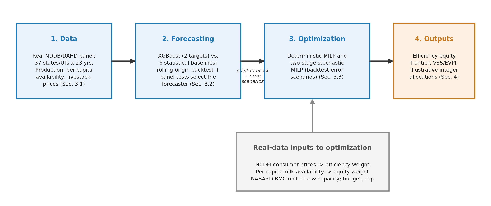

# Forecasting and Allocation for India's Dairy Supply Chain

Code and data for the paper **"Forecasting and Automated Infrastructure Allocation for India's Dairy Supply Chain: An Integrated Forecasting and Stochastic Optimization Decision-Support Framework Using Government Panel Data"** (P. Srivastava, IIT Mandi), submitted to IC_TORS'26.

The framework has two linked stages:

1. **Forecasting.** One-year-ahead state milk production is forecast for 37 Indian states/UTs (2001-02 to 2023-24). A tuned XGBoost model (level and growth-rate targets) is compared with six statistical baselines in a rolling-origin backtest, using panel-robust significance tests. The fixed-effects panel regression is selected.
2. **Allocation.** The selected forecasts drive a mixed-integer model that allocates a bulk-milk-cooler (BMC) budget across states under an efficiency–equity weight λ. A two-stage stochastic version uses the forecaster's own backtest errors as scenarios and reports VSS, EVPI and expected capacity utilisation.



## Repository layout

```
data/        raw and processed Government of India data (sources in data/SOURCES.md)
src/         analysis scripts (run in the order below)
results/     every table/number reported in the paper (CSV)
figures/     every figure (PNG)
scripts/     run_all.sh – runs the full pipeline
```

## Quick start

```bash
git clone https://github.com/<your-username>/dairy-forecast-allocation.git
cd dairy-forecast-allocation
python -m venv .venv && source .venv/bin/activate      # Windows: .venv\Scripts\activate
pip install -r requirements.txt
bash scripts/run_all.sh                                 # about 5 minutes on a laptop
```

On Windows without bash, run the scripts listed below one by one from the repository root, e.g. `python src/prep_data.py`.

All scripts must be run **from the repository root**, because they read `data/` and write `results/` and `figures/` using relative paths.

## Pipeline

| # | Script | What it does | Main outputs |
|---|--------|--------------|--------------|
| 1 | `src/prep_data.py` | Builds the state × year panel and lagged features | `data/state_year_panel_features.csv` |
| 2 | `src/eda.py` | Concentration (top-5 share, Gini), state growth rates | `results/regional_dispersion.csv`, `state_cagr.csv` |
| 3 | `src/forecast_model.py` | XGBoost (2 targets) + 6 baselines, 6-year rolling-origin backtest, 2024-25 forecasts | `forecast_metrics.csv`, `forecast_backtest_predictions.csv`, `next_year_state_forecasts.csv` |
| 4 | `src/forecast_significance.py` | MASE; state-clustered t-tests (Holm), Diebold–Mariano–HLN, state-block bootstrap | `forecast_metrics_with_mase.csv`, `forecast_panel_tests.csv` |
| 5 | `src/robustness_check.py` | Re-runs the backtest over 4-, 6- and 8-year windows | `robustness_backtest_windows.csv` |
| 6 | `src/optimize_allocation.py` | Deterministic MILP and λ frontier | `allocation_frontier.csv`, `allocation_recommendations.csv` |
| 7 | `src/optimize_stochastic.py` | Two-stage stochastic MILP with backtest-error scenarios; VSS, EVPI, utilisation | `stochastic_vss.csv`, `stochastic_allocations.csv` |
| 8 | `src/sensitivity_check.py` | ±20% unit cost/capacity, ±10 pp budget | `allocation_sensitivity.csv` |
| 9 | `src/sensitivity_systematic.py` | Budget-share × cap grid, alternative efficiency/equity proxies, frontier in real units | `sensitivity_budget_cap_grid.csv`, `sensitivity_proxies.csv` |
| 10 | `src/district_case_study.py` | District-level concentration (Maharashtra, Punjab, Andhra Pradesh) | `district_case_study_summary.csv` |
| 11 | `src/plot_results.py` | All figures | `figures/*.png` |

Steps 3 and 5 take most of the run time because of XGBoost tuning and per-state ARIMA fitting. Results are deterministic (fixed random seeds).

## Key results

| | |
|---|---|
| Most accurate forecaster (pooled MAE, 2018-19 to 2023-24) | Panel fixed-effects regression, 186.9 thousand t (MASE 1.278) |
| Growth-rate vs level-target XGBoost | MAE 220.9 vs 322.6 (−31.5%) |
| Value of the stochastic solution, equity-oriented plan (λ = 0) | 10.9% of the deterministic plan's expected value |
| Expected capacity utilisation of point-forecast plans | 68–76% |
| Cost of moving from pure efficiency to pure equity | 3.3% of capacity value; 10% of expected utilised capacity |

The allocations are illustrative decision scenarios. They are not investment plans, because the data are state-level and some inputs are proxies (see the paper's limitations).

## Data

All data are publicly published statistics from NDDB, DAHD, NCDFI, NABARD and the Open Government Data Platform India, retrieved in September 2026. `data/SOURCES.md` lists every file, its source URL and its known caveats. Nothing is synthetic or imputed, except the disclosed linear interpolation of the five-yearly livestock census.

## Requirements

Python 3.10 or later. Package versions are in `requirements.txt` (tested with numpy 2.4, pandas 3.0, scipy 1.17, scikit-learn 1.8, statsmodels 0.15, xgboost 3.2, matplotlib 3.10). The MILPs are solved with HiGHS through `scipy.optimize.milp`, so no commercial solver is needed.

## Citation

If you use this code or data, please cite the paper (full reference to be added after publication):

```
Srivastava, P.: Forecasting and Automated Infrastructure Allocation for India's Dairy Supply
Chain: An Integrated Forecasting and Stochastic Optimization Decision-Support Framework Using
Government Panel Data. IC_TORS'26 (2026).
```

## Acknowledgement

A generative AI model (Claude, Anthropic) assisted with data transcription, code implementation and drafting, under the author's direction. All results come from the deterministic code in this repository.
